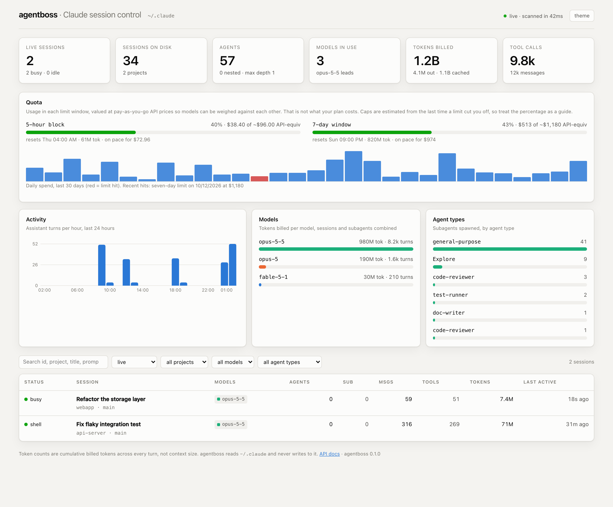

# agentboss

A single dashboard for every Claude Code session on this machine — which ones are
running, what models they are burning tokens on, and how many agents and
subagents each one has spawned.

**Documentation: <https://agentboss.readthedocs.io/>**



agentboss is a read-only observer. It reads the Claude Code state directory
(`~/.claude` by default) and never writes to it.

## Install

```bash
uv venv --python 3.12
uv pip install -e ".[dev]"
```

## Run

```bash
agentboss --open
```

The dashboard is at <http://127.0.0.1:8848/>, the OpenAPI docs at `/docs`.

```
agentboss [--host 127.0.0.1] [--port 8848]
          [--claude-home ~/.claude]
          [--refresh 1.0]        # min seconds between filesystem rescans
          [--allow-control]      # enable interrupt/terminate endpoints
          [--open] [--reload]
```

Equivalent environment variables: `AGENTBOSS_CLAUDE_HOME`,
`AGENTBOSS_REFRESH_INTERVAL`, `AGENTBOSS_ALLOW_CONTROL`.

## What it shows

**Stat tiles** — live sessions (busy vs idle), sessions on disk, agents and how
many of those are nested, distinct models in use, cumulative tokens, tool calls.

**Activity** — assistant turns per hour across every session and subagent.

**Models** — tokens billed per model, main loops and subagents combined.

**Quota** — how much of your plan's usage limits you have burned. Claude Code
does not write live utilisation to disk, so agentboss maps it: every turn is
weighted by its API-equivalent price (cache reads at 0.1x, cache writes at
1.25x) and summed over the same windows the limits use — the current 5-hour
block and the 7-day week. When a request is refused, the transcript records a
`quotaLimits` object (`rateLimitType`, `resetsAt`); the spend in that window at
the first rejection becomes the estimated cap, and the 7-day window is pinned to
the recorded reset time. Meters show spend, % of the estimated cap and the
on-pace projection; below them, 30 days of daily spend with limit-hit days in red.
The dollar figures are a proxy for quota, not a bill.

**Agent types** — how many subagents of each type (`general-purpose`, `Explore`,
`Plan`, and any project-defined agents) have been spawned.

**Session table** — one row per session with status, models, agent and subagent
counts, messages, tool calls and tokens. Filter by status, project, model or
agent type; search across ids, titles, projects and last prompts. Click a row for
the detail drawer: full metadata, token split, top tools, and a card per subagent
showing its type, description, spawn depth, model, duration and token cost. The
open session is reflected in the URL (`/#/session/<id>`), so a view is
bookmarkable.

The page holds an SSE connection and repaints when the numbers actually change,
so it stays current without polling the disk from the browser.

## Where the data comes from

```
~/.claude/
  sessions/<pid>.json                     live registry: pid, status, cwd, name
  projects/<encoded-cwd>/
    <session-id>.jsonl                    main transcript
    <session-id>/subagents/
      agent-<id>.jsonl                    subagent transcript
      agent-<id>.meta.json                agent type, description, spawn depth
  tasks/<session-id>/<n>.json             task-list items
```

Three details drive the implementation:

1. **Transcripts are append-only and large** (tens of MB). Each file gets an
   `IncrementalTranscript` that remembers a byte offset and a running aggregate,
   so a rescan only parses bytes that were appended since the last look. A
   truncated or replaced file resets the offset and is re-read.

2. **One API turn is written as several `assistant` records** — one per content
   block (thinking / text / tool_use) — and every one repeats the same
   `message.usage`. Counting each record would multiply tokens by the number of
   blocks, so usage is credited once per `message.id`. Tool calls, which are
   genuinely per-record, are counted per record.

3. **A registry entry outlives a crash.** Liveness is not "the pid exists" — pids
   get recycled — so the pid must also still *be* a Claude process, checked
   against the command name `ps` reports. (The recorded `procStart` string can't
   serve here: `ps -o lstart` formats it per-locale, in a different field order,
   and the two clocks disagree by an hour across a DST boundary.) Liveness is
   never decided by a clock: the CLI only rewrites its registry file when its
   status changes, so a quiet `updatedAt` means "still on one long tool call",
   not "gone".

Token counts throughout are *cumulative billed tokens* summed over every turn,
not the size of any context window.

## Session status

| Status  | Meaning |
|---------|---------|
| `busy`  | Process alive and working (the CLI's own word for it — `busy`, `shell`, … — is kept in `activity_state`) |
| `idle`  | Process alive, waiting on you |
| `stale` | Registry entry exists but the process is gone |
| `ended` | Transcript on disk, no registry entry |

## Controlling sessions

Read endpoints are always available. The two endpoints that signal a real
process are mounted only with `--allow-control`:

```bash
agentboss --allow-control
curl -X POST localhost:8848/api/sessions/<id>/interrupt   # SIGINT
curl -X POST localhost:8848/api/sessions/<id>/terminate   # SIGTERM
```

They act on a live CLI that may be mid-edit, so they are off by default and the
UI confirms before sending.

## API

| Endpoint | Returns |
|---|---|
| `GET /api/overview?hours=24` | Tiles, model mix, agent-type mix, activity timeline |
| `GET /api/quota?days=30` | 5-hour and 7-day spend, estimated caps, limit hits, daily history |
| `GET /api/sessions` | Sessions; `status`, `project`, `model`, `agent_type`, `q`, `sort`, `order`, `limit`, `offset` |
| `GET /api/sessions/{id}` | One session with every subagent |
| `GET /api/agents` | Subagents across sessions; `session_id`, `agent_type`, `model`, `live_only` |
| `GET /api/models` | Tokens and turns per model |
| `GET /api/projects` | Sessions grouped by working directory |
| `GET /api/filters` | Distinct values for the filter controls |
| `GET /api/stream` | SSE; pushes a fresh overview when the numbers change |
| `POST /api/sessions/{id}/{interrupt,terminate}` | Requires `--allow-control` |

## Development

```bash
uv pip install -e ".[dev,docs]"
uv run python -m invoke test         # test suite
uv run python -m invoke docs         # build the docs site, warnings are errors
uv run python -m invoke docs-serve   # live-reloading preview on :8000
```

The docs site lives in `docs/` (Sphinx with Markdown pages via MyST) and is
published on Read the Docs. Regenerate the dashboard screenshot with
`scripts/screenshot.py` against a running instance; it anonymises the page first.

The suite builds a synthetic `~/.claude` tree, so it never touches your real one.
